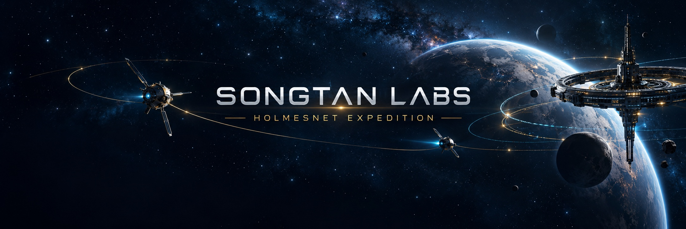
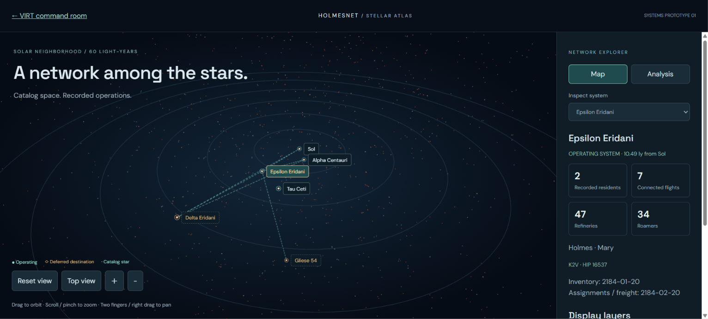
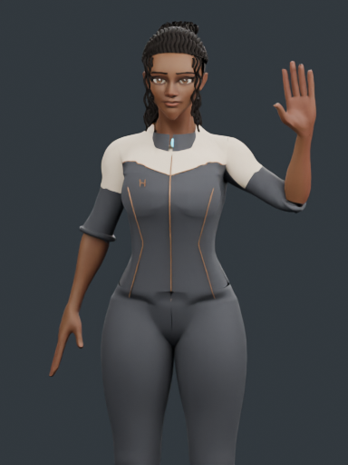

# HolmesNet Expedition

**From one factory to four systems.** An independent fan campaign and mobile/desktop companion for [Bobiverse: Replicant Too](https://replicate.anek.online).

**[Open the interactive companion](https://jvholmes87.github.io/holmesnet-expedition/)** · **[Read Expedition 001 on X](https://x.com/jasonvonholmes/status/2111452094502977841)** · [Campaign instructions](docs/first-expedition.md) · [Evidence and limitations](docs/evidence.md) · [Campaign JSON](data/campaign.json)

Created by **Jason Von Holmes / Songtan Labs**. This project connects 15 years of Air Force engineering experience, a computer science degree and graduate IT studies with a systems engineering focus: plan, observe, document and improve.

## VIRT command environment — October 2026

**[Enter the command room](https://holmesnet-virt.rosypeony128.chatgpt.site/)** · **[Explore the stellar atlas](https://holmesnet-virt.rosypeony128.chatgpt.site/systems.html)** · **[Development progress and video](docs/virt-development.md)**

VIRT turns this campaign into a working virtual command environment. The approved warm wood and mountain setting now accompanies a 3D nearby-star atlas, six console-specific operational workspaces, and Map/Analysis views. The aim is to learn through building, testing and documenting, with future applications in engineering and autonomous-system management.

*The approved Systems-map prototype, captured October 18. The October 19 v0.6 rollout adds station-specific workspaces and catalog-projected room displays.*

**October 31: GUPPI Refinement 07 is live and accepted in Jason’s Android review.** The knee and boot weights, standing collar, cuff fit, viewer lighting and portrait camera were repaired. The GLB shrank from 11.37 MB to 6.81 MB. Jason confirmed front, side, back and portrait; Idle, Listening, Explaining and Greeting (raise, two waves, return); the visible cyan collar light and bronze edge; no nose streak; cuffs over boots; and acceptable mobile-data loading. This is user acceptance, without a measured frame rate or load time. [Meet GUPPI](https://holmesnet-virt.rosypeony128.chatgpt.site/guppi.html) · [R07 engineering evidence](https://github.com/jvholmes87/holmesnet-expedition/issues/1) · [Detailed progress](docs/virt-development.md).

### GUPPI — from approved concept to animated character

| Approved Concept 03 | Refinement 07 actual model |
|---|---|
|  |  |

*Concept 03 remains the design target. R07 is an accepted engineering pass, not a final likeness match. The repo’s older PNG and greeting MP4 below are historical Refinement 02 review media.*

| Knee and boot comparison | Collar comparison | WebGL lighting comparison |
|---|---|---|
|  |  |  |

**[▶ Watch the historical Refinement 02 greeting (MP4)](assets/guppi/greeting-review.mp4)** · [Open the current interactive studio](https://holmesnet-virt.rosypeony128.chatgpt.site/guppi.html)

The R07 site suite passed **31 tests**. Face and hair likeness, skin calibration, garment detail, seated hem clipping, expression and lip-sync remain open. The app uses dated game snapshots; catalog positions do not imply live vessel tracking.

## V0.1 companion

- Select systems on a keyboard-accessible schematic map.
- Inspect local inventory and installed infrastructure.
- Search the six-person roster and filter by assignment group.
- Review completed, active and deferred missions.
- Sort nine freight flights by arrival proximity, destination or cargo.
- Explore a dated campaign timeline and prepared MAAT briefings.
- Download the campaign JSON and roster CSV.

The companion presents dated campaign snapshots, with a schematic map, local inventories and mission history.

## Current campaign checkpoint

**February 20, 2184:** four operating systems, six replicants, 77 roamers, 24 total freighters and nine flights. Global stored stock: **80,095 parts / 653,992 ore**.

| System | Team | Campaign assignment |
|---|---|---|
| Epsilon Eridani | Holmes + Mary | Home command and industry |
| Sol | Octavia | Resident Bob support |
| Alpha Centauri | Mae | Resident Bob support |
| Tau Ceti | Banneker + Katherine | SEED-01 physical expedition |

System inventories are dated **January 20, 2184**, one month earlier than the global header. Historical cargo holds are dated **August 9, 2174**. Each view keeps those distinctions visible.

Future missions **BEAM-DELTA-01** and **BEAM-GL54-01** are deferred to another gameplay session. Jason reports that beaming to Delta Eridani and Gliese 54 is available; resident choices and current quotes remain pending. Neither destination is counted as an operating player system.

## Credits

**Bobiverse: Replicant Too was created by [u/damiankw](https://www.reddit.com/user/damiankw/).** [Play his game](https://replicate.anek.online) and read his [original introduction](https://www.reddit.com/r/bobiverse/comments/1wx75mh/bobiverse_replicant_too_an_interactive_game_based/). The Bobiverse books and setting were created by **Dennis E. Taylor**.

HolmesNet is an independent player-made campaign companion. Our aim is to help more people discover the game, give players a documented expedition to follow, and provide useful gameplay observations and constructive feedback to its creator. This project has no claimed endorsement.

The avatar and banner were created for Songtan Labs / HolmesNet using OpenAI image generation.
