# VIRT development — From architecture to operational maps

Updated October 31, 2026 · Jason Von Holmes / Songtan Labs

**[Enter VIRT](https://holmesnet-virt.rosypeony128.chatgpt.site/)** · **[Open the stellar workspace](https://holmesnet-virt.rosypeony128.chatgpt.site/systems.html)**

## October 31 engineering log — GUPPI Refinement 07 and Android acceptance

[Open the live R07 model](https://holmesnet-virt.rosypeony128.chatgpt.site/guppi.html) · [Review the defect-by-defect measurements and images](https://github.com/jvholmes87/holmesnet-expedition/issues/1#issuecomment-6537044082) · [Read the R07 asset notes](https://holmesnet-virt.rosypeony128.chatgpt.site/assets/guppi/README.md)

Refinement 06 repaired the open lower clothing shell, but pose and WebGL inspection exposed measurable defects: the trouser weight transition bent below the knee; the boots were partly driven by the opposite leg; the standing collar became a chest plate over its light; cuffs flared away from the boots; and an unshadowed back light drew a bright streak down the nose. Refinement 07 resampled the trouser weights at the actual knee, isolated each boot to its own leg, built a closed collar band and tapered cuffs, and changed the viewer lights and portrait camera. Removing unused vertex attributes reduced the GLB from 11.37 to 6.81 MB. The R07 review package has pose measurements, reimport renders, WebGL comparisons, a validation report and 31 passing site tests.

| R06 → R07 leg/boot motion | R06 → R07 standing collar | R06 → R07 WebGL |
|---|---|---|
|  |  |  |

**Jason’s Android acceptance:** He confirmed front, side, back and portrait; Idle, Listening, Explaining and Greeting with two waves and return to rest; the bronze-edged collar and visible cyan light without a chest plate; no nose streak; cuffs over boots; and acceptable mobile-data loading. This is a user observation, not a measured frame-rate or network benchmark. The R07 pass is accepted. The seated 90° pose still clips the jacket hem by up to 3.8 mm in the engineering sweep, and the face, hair, skin palette, cargo details, expression and voice remain on the path toward the Concept 03 material reference. Earlier sections below remain dated history, including the phone rejection of R05.

## October 26 engineering log — GUPPI geometry defects and repair

**[Open the live Refinement 05 model](https://holmesnet-virt.rosypeony128.chatgpt.site/guppi)** · **[Download its GLB](https://holmesnet-virt.rosypeony128.chatgpt.site/assets/guppi/guppi-rig.glb)**

Jason inspected Refinement 04 on a WebGL-capable phone. The screenshots below are direct device captures of the actual interactive model, not concept art. They revealed defects that geometry-integrity tests alone did not catch: exposed triangular skin beneath the collar, a protruding front trouser surface, distorted knee shape, and gaps at the trouser/boot connection. This is an example of why a valid skinned GLB is not sufficient evidence of visual quality.

| Front: trouser and knee defects | Portrait: neckline gaps | Side: boot and leg join |
|---|---|---|
| 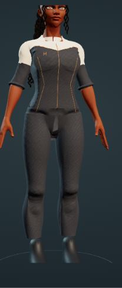 | 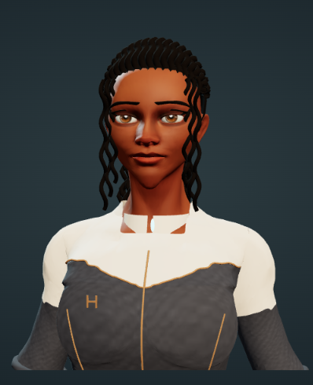 | 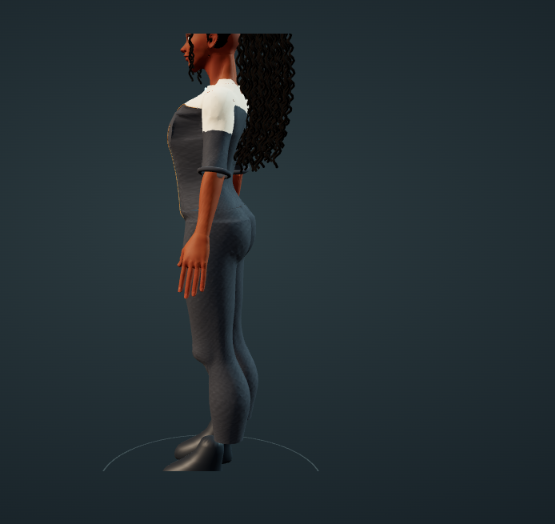 |

**Correction:** Refinement 05 extends the weighted trouser hems into the boot shafts, flares the collar's lower ring to overlap the cream yoke cutout, shifts the collar light back, and reduces the protruding front pelvic surface. The changes are applied to the exported geometry without changing skin weights, UVs, the 65-joint skeleton, or four animation clips. The production VIRT studio and downloadable GLB have been updated. The existing greeting video predates these geometry changes and is retained as motion history.

**Verification:** GLB header, finite positions, accessor bounds, 65 joints, and byte-identical animation/skin JSON were checked against Refinement 04. The Site's 30 selected tests passed. **Visual outcome remains pending fresh phone screenshots**; the images above document the problem before Refinement 05, not proof that the correction looks right. The face likeness, tailoring, knee detail, and greeting deformation remain separate work.

### Refinement 05 phone review — visual rejection

The next phone captures test the published Refinement 05 GLB. The collar/yoke coverage and trouser-to-boot overlap changed, but **the clothing mesh is not accepted**: a large triangular fold and dark opening remain at the front crotch; the collar retains a white slit at center; the knee silhouette still has abrupt bulges. The rear view suggests improved hem overlap, but a static screenshot does not establish deformation quality in motion. These observations supersede the initial geometry-pass assessment above.

| Front clothing defect, after pass | Collar slit, after pass | Rear hems, after pass |
|---|---|---|
| 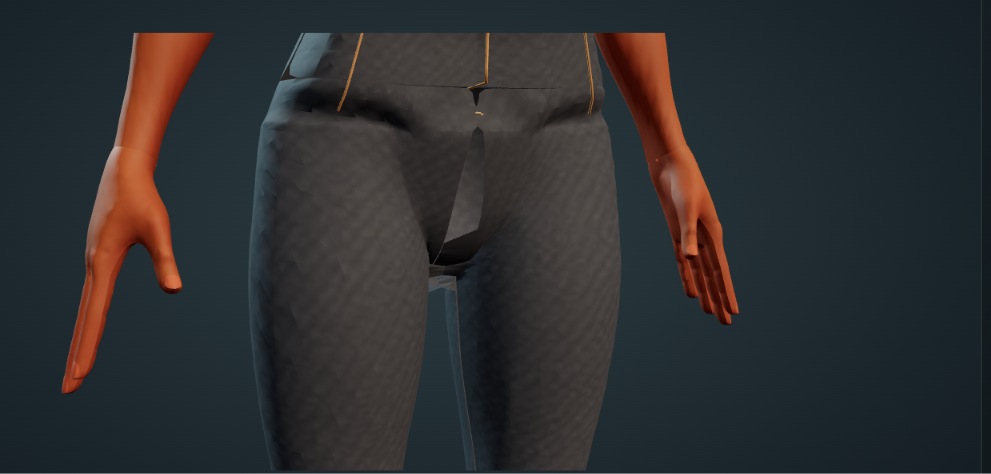 | 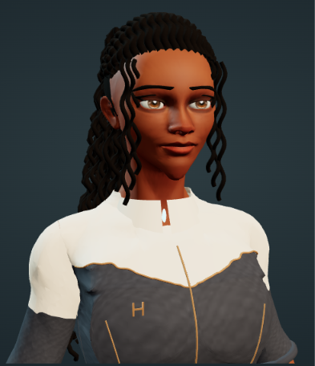 | 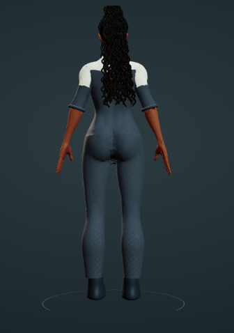 |

**Additional underside review:** The angled underside captures reveal an open trouser-to-boot gap and visibly separate boot shafts, despite the more convincing straight-on rear view. The previous statement that hem overlap appeared improved is limited to that rear angle and does **not** establish a repaired connection. This is an unresolved defect requiring a connected mesh and animation/deformation inspection. 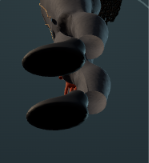\n\n**Engineering conclusion:** Position-only edits to the inherited weighted body surface are insufficient. The next pass should repair or replace the trouser crotch topology, build a closed collar/yoke connection, and review knee and boot deformation in actual motion. Keep this as an open defect; GLB integrity and 30 passing site tests did not predict shaded visual acceptance. The approved Concept 03 image also appears cropped to a narrow strip in GitHub's preview, so its repository asset/display needs inspection before it can serve as reliable comparison evidence.

## October 26 update — GUPPI material study

**[Inspect GUPPI in VIRT](https://holmesnet-virt.rosypeony128.chatgpt.site/guppi.html)** · **[Download the updated GLB](https://holmesnet-virt.rosypeony128.chatgpt.site/assets/guppi/guppi-rig.glb)**

A Runway-derived front view now guides Concept 03's warm complexion and tailored graphite uniform. The generated UV sheet moved facial and clothing features, so we did not wrap it wholesale around the existing mesh. Instead, the updated GLB uses a palette transfer on the original skin UV layout and an embedded, restrained graphite weave on the weighted uniform. This is a material study; face shape, hair volume, jacket tailoring and trouser geometry still need refinement. The 65-joint skeleton and Idle, Listening, Explaining and one-shot Greeting clips are unchanged.

| Approved design | New material reference | Rig study before material pass |
|---|---|---|
|  | 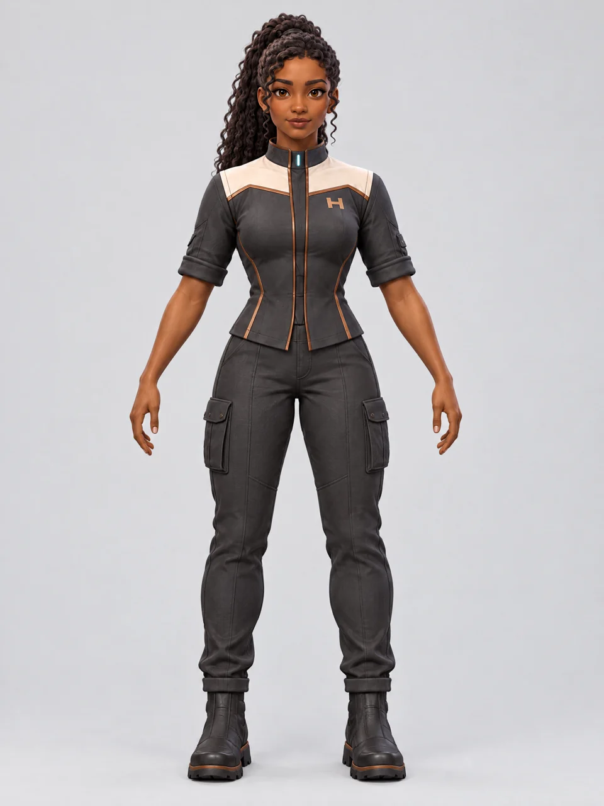 | 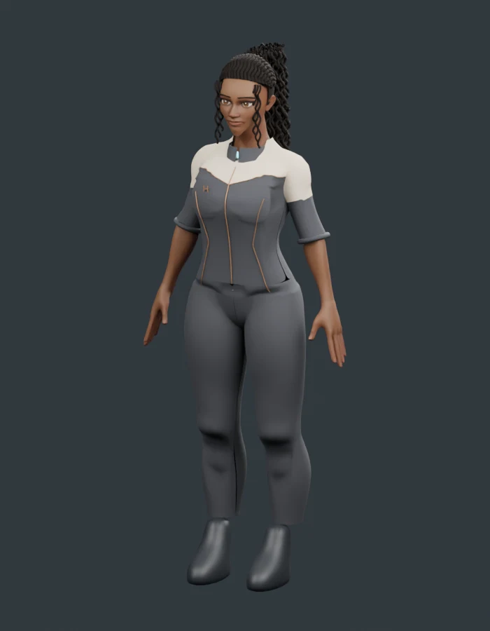 |

*The middle image is 2D reference art; the right image is the previous model render. The updated material pass is in the downloadable GLB and interactive VIRT studio on WebGL-capable devices. This QA browser had no WebGL, so shaded-device appearance remains unverified.*

## October 23 update — GUPPI refinement and Sol explorer

**[Meet GUPPI](https://holmesnet-virt.rosypeony128.chatgpt.site/guppi.html)** · **[Watch the corrected greeting](../assets/guppi/greeting-review.mp4)** · **[Explore Sol](https://holmesnet-virt.rosypeony128.chatgpt.site/sol.html)**

GUPPI now has an initial animated 3D model based on Quaternius's CC0 Universal Base Characters. Jason approved Concept 03: long curls, warm brown skin, a natural athletic build, and a graphite command uniform with a cream yoke and bronze trim. The approved concept remains the visual target; the 3D likeness is still being refined.

The October 23 refinement softens the face, improves the uniform panel and trim, and corrects the greeting. The hand raises with the palm forward and elbow below the shoulder, waves, and returns to rest. Sleeve-cuff weights follow the bending sleeve. Greeting playback runs once and supports replay.

### GUPPI — from approved concept to animated character

| Approved Concept 03 | Current 3D refinement |
|---|---|
|  |  |

*Concept 03 is the design target. Refinement 02 is the working 3D model; likeness polish remains underway.*

**[▶ Watch the greeting — 4 seconds (MP4)](../assets/guppi/greeting-review.mp4)** · [Open the interactive studio](https://holmesnet-virt.rosypeony128.chatgpt.site/guppi.html)

*Click the preview to play the exported-animation review: raise, palm-forward wave, and return to rest. This is a rendered motion review, not browser gameplay footage.*

### Face and uniform detail

| Portrait | Rear view |
|---|---|
| 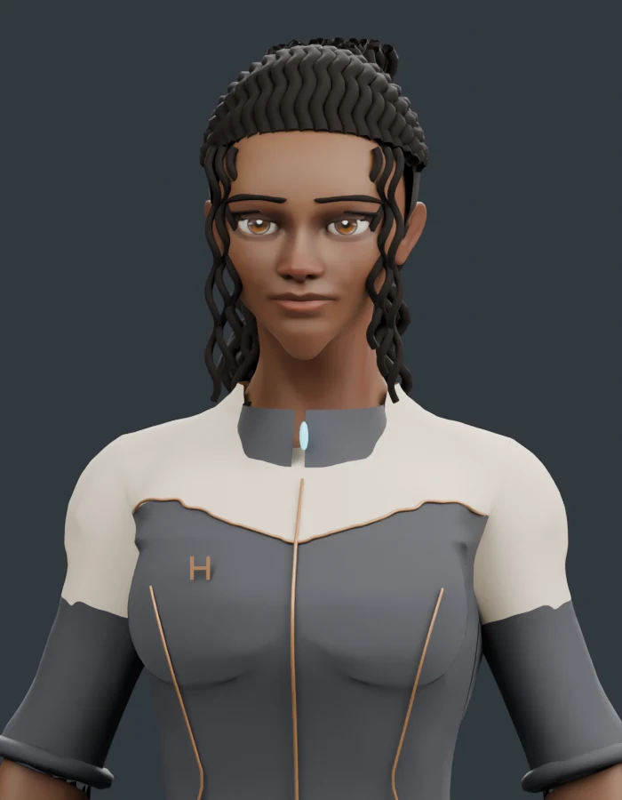 | 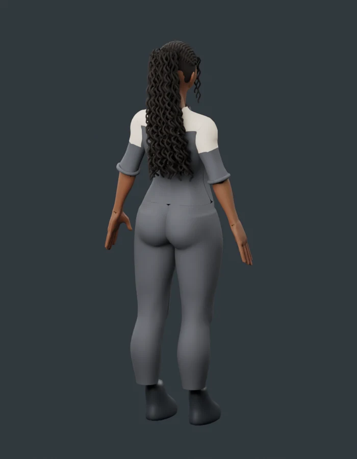 |

*Actual model renders show the face, uniform and hair from complementary views. These images document the current pass rather than final visual acceptance.*

The model contains 65 joints and four clips: Idle, Listening, Explaining and Greeting. Export validation checked finite geometry at 20 samples across the four clips, palm orientation and wrist/elbow placement during the wave, and matching start/end landmarks. The selected automated suite passed 30 tests, including one-shot greeting and replay behavior. Browser WebGL was unavailable, so interactive GPU playback and real phone/PC performance remain unverified.

The October 22 Sol explorer adds textured previews of the Sun, eight planets and Moon. Detail textures load on demand; optional Milky Way backgrounds load only when enabled. Body sizes, orbit spacing/phases and lighting are illustrative, not an ephemeris or new campaign evidence.

### Next work

- Review likeness, uniform trim, hair and greeting deformation against Concept 03 on phone and desktop.
- Refine facial expressions; implement voice, lip-sync and the live assistant connection.
- Resume the book-inspired VIRT menus and screens after GUPPI review.

Concept approval does not mean the current 3D likeness has final acceptance. The uploaded version 1 captures remain historical evidence, separate from refinement 02.

## Why build this?

HolmesNet began as a documented expedition through Bobiverse: Replicant Too. VIRT explores how a virtual command environment can make a growing campaign easier to understand: where our replicants are assigned, what is moving between systems, and which decisions still need evidence.

The longer-term goal is to explore similar interfaces for engineering projects, autonomous systems and operational management. That is a development direction, not a claim that this game prototype is ready for real-world control.

## Development stages

| Stage | Outcome |
|---|---|
| Architecture | Approved room proportions, viewpoints, sightlines and circulation. |
| Functional Prototype 1 | Navigable room, console records, filters, roster search and prepared briefings. |
| Visual design | Warm wood and earth tones with a mountain outlook. |
| Runway treatment | Photorealistic visual reference and concept motion; the live cinematic view composites functional displays over a still. |
| Stellar atlas | Three.js navigation and 1,568 HYG catalog stars within 60 light-years. Systems-map direction approved October 18. |
| Console rollout — v0.6 | Six station-specific stellar workspaces, operational layers and Map/Analysis modes. Catalog projections now appear on room displays. Device review remains open. |

## Screenshots and demonstration

*Jason's October 18 capture of the approved Systems-map prototype: catalog positions, system selection and dated campaign records.*

*Jason's October 18 capture of the Runway-inspired room implementation. This records v0.5, before the October 19 console rollout.*

**[Watch the 20-second walkthrough excerpt](../assets/virt/virt-walkthrough-excerpt.mp4)**

The excerpt shows the interactive room in the October 18 recording. It is silent and trimmed from the supplied implementation video; it is not a live feed or footage of the later rollout.

## Each console has a purpose

| Console | Operational view |
|---|---|
| Systems | Operating systems, recorded infrastructure and deferred destinations. |
| Missions | Deferred beam objectives and separately identified supply freight. No invented beam dispatches. |
| Replicants | Last-confirmed system assignments, roles and groups, with resident search. |
| Logistics | Recorded freight corridors, cargo totals, remaining times and system-level infrastructure layers. |
| Archives | Evidence coverage and dated historical milestones. |
| Command | Network summary, residents, freight and future objectives. |

Choose **Open stellar workspace** from a console to use its 3D map. The station and selected system carry into the workspace. Compact console panels retain an accessible schematic fallback.

## Evidence and limitations

- Catalog coordinates are HYG J2000.0 astronomical context, not verified game geometry or positions propagated to game year 2184.
- Alpha Centauri uses its primary star as the representative marker, not the system barycenter.
- Replicant positions mean last-confirmed system assignments. Exact vessel and facility coordinates are unknown.
- Freight lines show recorded connections. Remaining travel times are frozen checkpoint values.
- System inventory is dated January 20, 2184; assignments and freight are confirmed through February 20, 2184. Historical hold cargo has its own earlier date.
- The cinematic room is a composited still with functional overlays. The separate navigable room uses simplified geometry.
- No live game synchronization, autonomous orders or headset validation is claimed.
- The October 19 atlas milestone passed 29 checks; the October 23 selected suite passed 30, including greeting playback. These counts describe different milestone suites. R07 passed 31 site tests and Jason accepted its Android visual and motion review on October 31; PC, VR and measured performance benchmarks remain open.

## Credits and reuse

**Bobiverse: Replicant Too** was created by **[u/damiankw](https://www.reddit.com/user/damiankw/)**. **[Play the original game](https://replicate.anek.online/)**. Dennis E. Taylor created the Bobiverse books and setting. HolmesNet is an independent fan project intended to encourage discovery of the game and document constructive gameplay observations.

Three.js is MIT licensed. The adapted HYG v4.1 star dataset credits David Nash / Astronexus and is distributed under CC BY-SA 4.0. [Dataset and transformation notes](https://holmesnet-virt.rosypeony128.chatgpt.site/data/README.md). Runway supplied the architectural treatment; the screenshots and demonstration are Jason's project captures.

GUPPI's base character is by Quaternius (CC0); custom character changes build on that foundation. [Asset notes and attribution](../assets/guppi/README.md). Solar System Scope / INOVE textures are used under CC BY 4.0; [per-asset provenance](https://holmesnet-virt.rosypeony128.chatgpt.site/textures/sources.json) records sources and resized derivatives. Some source colors are enhanced and terrain is fictional.

The campaign companion source lives in this repository. The newer VIRT application is deployed separately; this page documents and links to that working application.
